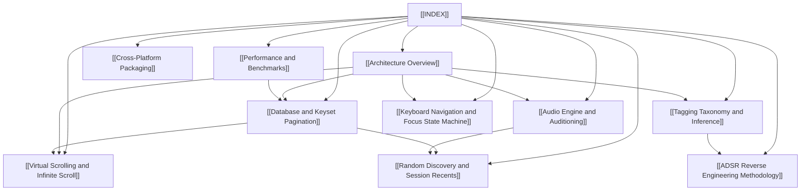

# LocSamp Documentation Wiki

> Central knowledge graph and architectural specification for **LocSamp** — high-performance, native Rust audio sample manager with zero-latency auditioning, local SQLite persistence, automatic taxonomic tagging, and vim-first keyboard navigation.

---

## Knowledge Graph Navigation

---

## Core Clusters

### 1. System Architecture & Core Concepts
- [[Architecture Overview]] — System decomposition, crate boundaries (`gui`, `cli`, `audio`, `db`, `scanner`, `search`, `tagging`, `embedded`, `import-adsr`), and dataflow.
- [[Database and Keyset Pagination]] — Embedded SQLite schema, natural collation (`NATURALNOCASE`), FTS5 full-text indexing, and window function total counts.
- [[Virtual Scrolling and Infinite Scroll]] — `egui_extras::TableBuilder` virtualization, 500-chunk prefetching, sub-2ms query execution, and unbounded scrolling.

### 2. Audio Auditioning & Discovery
- [[Audio Engine and Auditioning]] — Non-blocking Symphonia decoding on background threads, CPAL ring buffers, synthetic audition fallback, and waveform peak computation.
- [[Random Discovery and Session Recents]] — SplitMix64 uniform randomization across the full library, accumulating Randomize View ($1, 2, \dots, N$), in-memory Session Recents history, and hotkey workflows (`r` / `Shift+R`).

### 3. Intelligence & Taxonomy
- [[Tagging Taxonomy and Inference]] — Clean-room rule engine, 38 genres, 24 drum categories, parent folder inheritance up to 10 levels, multi-word n-grams, and non-resurrection of dismissed tags.
- [[ADSR Reverse Engineering Methodology]] — Static binary analysis using Ghidra, SQLite schema extraction, rule mining, and validation against a 150GB test corpus.

### 4. User Experience & Deployment
- [[Keyboard Navigation and Focus State Machine]] — Vim motion bindings (`j`/`k`, `gg`/`G`, `yp`/`yy`, `/`, `<Esc>`), deterministic focus transitions between search box and sample list, and seamless click blurring.
- [[Cross-Platform Packaging]] — Native macOS `.app` bundle generator (`scripts/build-macos-app.sh`), Nix flake / `nix-shell` workflows, Linux X11/Wayland support, and application data directory specifications (`default_db_path`).
- [[Performance and Benchmarks]] — Empirical benchmarks comparing LocSamp to ADSR Sample Manager on ~150 GB (30s vs 60m on SSD, 7.5h on HDD).

---

## Cross-Cutting Reference Indexes

| Topic | Primary Spec | Source Code Reference |
| :--- | :--- | :--- |
| **GUI & State** | [[Architecture Overview]] | [`crates/gui/src/main.rs`](file:///Users/amon/Projects/AI/Sandboxes/cloud/work/sample-manager/crates/gui/src/main.rs) |
| **Audio Playback** | [[Audio Engine and Auditioning]] | [`crates/audio/src/lib.rs`](file:///Users/amon/Projects/AI/Sandboxes/cloud/work/sample-manager/crates/audio/src/lib.rs) |
| **Search & Pagination** | [[Database and Keyset Pagination]] | [`crates/search/src/lib.rs`](file:///Users/amon/Projects/AI/Sandboxes/cloud/work/sample-manager/crates/search/src/lib.rs) |
| **Tagging Rules** | [[Tagging Taxonomy and Inference]] | [`crates/tagging/src/lib.rs`](file:///Users/amon/Projects/AI/Sandboxes/cloud/work/sample-manager/crates/tagging/src/lib.rs) |
| **Scanner Engine** | [[Performance and Benchmarks]] | [`crates/scanner/src/lib.rs`](file:///Users/amon/Projects/AI/Sandboxes/cloud/work/sample-manager/crates/scanner/src/lib.rs) |
| **ADSR Import** | [[ADSR Reverse Engineering Methodology]] | [`crates/import-adsr/src/lib.rs`](file:///Users/amon/Projects/AI/Sandboxes/cloud/work/sample-manager/crates/import-adsr/src/lib.rs) |

---

## Raw Research & Reference Archives
- `docs/raw/adsr-db-notes.md` — SQLite schema extracted from ADSR Sample Manager runtime databases.
- `docs/raw/observed-behavior.md` — Reverse-engineered behavioral anomalies in commercial sample managers.
- `docs/raw/benchmarks.md` — Initial throughput and indexing rate logs.
