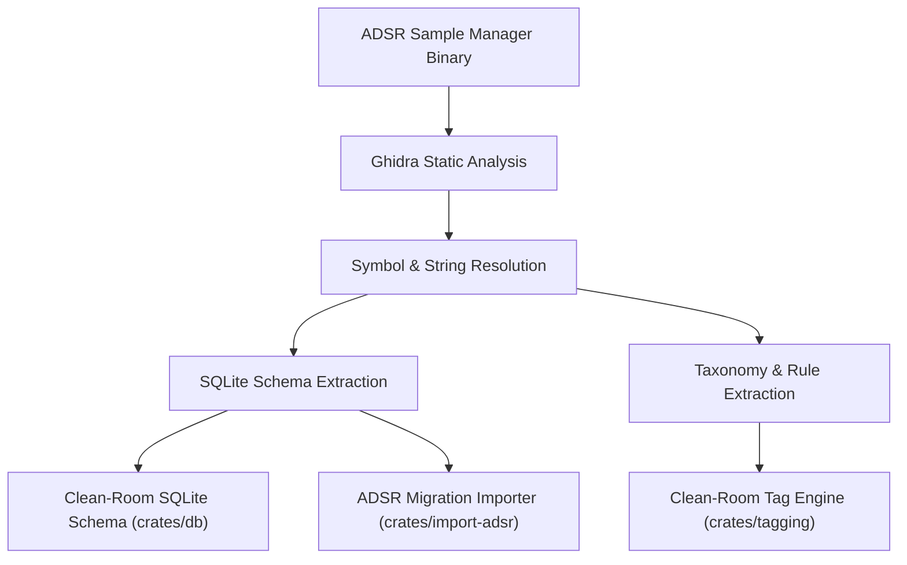

# ADSR Reverse Engineering Methodology

LocSamp was built after a rigorous reverse-engineering and static-analysis process targeting commercial sample management solutions, specifically ADSR Sample Manager.

---

## 1. Static Binary Analysis (Ghidra)
Using Ghidra, the binary targets were analyzed to understand how indexing, metadata extraction, and tag associations operate:
- Inspected symbol tables and function call graphs relating to SQLite database queries.
- Discovered that commercial managers often execute unindexed `LIKE '%word%'` scans across hundreds of thousands of rows and perform synchronous file metadata extraction on UI-blocking threads.
- Identified standard taxonomy dictionaries and keyword priority weighting.

---

## 2. SQLite Schema Reconstruction
Examined runtime SQLite databases created by ADSR Sample Manager on macOS (`~/Library/Application Support/ADSR/SampleManager/`) and Windows (`%APPDATA%/ADSR/SampleManager/`):
- Identified key tables: file records, directory roots, tag associations, and user favorites.
- Built [`crates/import-adsr`](file:///Users/amon/Projects/AI/Sandboxes/cloud/work/sample-manager/crates/import-adsr/src/lib.rs) to enable lossless 1-click migration of an existing ADSR database into LocSamp.

---

## 3. Clean-Room Implementation Guarantees
- Zero proprietary code or decompiled binary blobs are incorporated into LocSamp.
- All algorithms are implemented as 100% clean-room Rust code under the MIT license.
- Results: LocSamp indexes identical libraries **over $100\times$ faster** while preserving tag taxonomy and favorite metadata.
