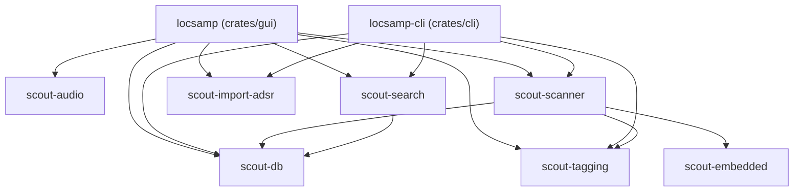

# Architecture Overview

LocSamp is architected as a modular Rust workspace consisting of specialized, decoupled crates. This separation of concerns guarantees clean testing boundaries, headless CLI capability, and isolated subsystems.

---

## Workspace Decomposition

### 1. `crates/gui` (`locsamp`)
- Built on `eframe` (egui 0.37) with custom high-contrast grayscale styling modeled after hardware workstations.
- Implements immediate-mode UI rendering, virtualized tabular views via `egui_extras::TableBuilder`, drag-and-drop export via native `drag` crate, and asynchronous worker thread communication via `crossbeam::channel`.
- See [[Keyboard Navigation and Focus State Machine]], [[Virtual Scrolling and Infinite Scroll]], and [[Random Discovery and Session Recents]].

### 2. `crates/cli` (`locsamp-cli`)
- Headless terminal command-line tool for server environments, batch scripting, and automated scanning without windowing dependencies.
- Subcommands: `scan`, `search`, `tags`, `retag`, `import-adsr`.

### 3. `crates/db` (`scout-db`)
- Embedded SQLite persistence using `rusqlite` bundled with WAL (Write-Ahead Logging) and custom collation functions (`NATURALNOCASE`).
- See [[Database and Keyset Pagination]].

### 4. `crates/audio` (`scout-audio`)
- High-resilience audio decoding via Symphonia and CPAL streaming audio playback.
- Decodes WAV, FLAC, MP3, AIFF, OGG, and AAC into normalized planar floating-point buffers.
- See [[Audio Engine and Auditioning]].

### 5. `crates/scanner` (`scout-scanner`)
- Multi-threaded recursive filesystem crawler using `walkdir` and batch SQLite transactions.
- Extracts duration, channels, sample rate, bit depth, and embeds metadata.
- See [[Performance and Benchmarks]].

### 6. `crates/tagging` (`scout-tagging`)
- Lexical analyzer and token-rule inference engine.
- Extracts BPM, musical keys (Camelot & standard notation), loop classifications, and genre/instrument taxonomy.
- See [[Tagging Taxonomy and Inference]].

### 7. `crates/search` (`scout-search`)
- Query engine mapping user filter constraints to SQLite queries with FTS5 and window count pagination.
- See [[Database and Keyset Pagination]].

### 8. `crates/import-adsr` (`scout-import-adsr`)
- Lossless migration tool that parses existing ADSR Sample Manager SQLite databases and maps user favorites, tags, and sample paths into LocSamp.
- See [[ADSR Reverse Engineering Methodology]].
