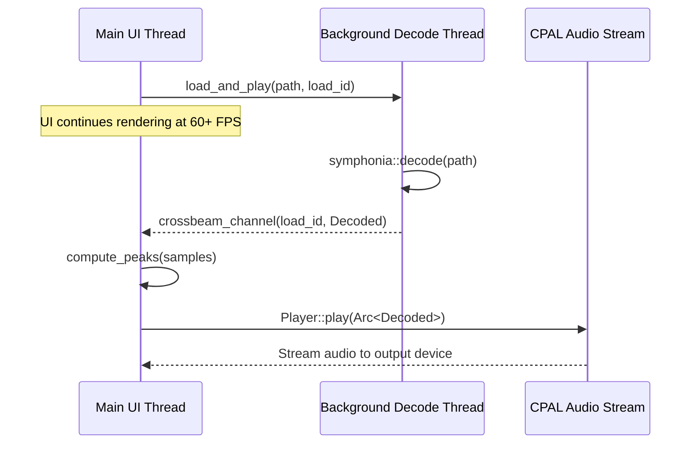

# Audio Engine and Auditioning

The LocSamp audio subsystem ([`scout-audio`](file:///Users/amon/Projects/AI/Sandboxes/cloud/work/sample-manager/crates/audio/src/lib.rs)) is designed for instant playback response and zero UI stuttering during sample discovery.

---

## Architectural Principles

1. **Non-Blocking Decode Pipeline**:
   The GUI main thread never performs disk I/O or codec decompression. When a sample is selected, a unique `load_id: u64` is incremented, and a worker thread decodes the file using [Symphonia](https://github.com/pdeljanov/Symphonia).

2. **Synthetic Audition Fallback**:
   If a sample path is missing or encounters a decoding failure, LocSamp synthesizes an audition sound in memory (e.g. 55 Hz sine drop for 808s, noise transient for snares) so producers still receive auditory feedback without throwing unhandled exceptions.

3. **Loop Mode & Retriggering**:
   - Loops automatically loop continuously during auditioning.
   - One-shots play through once and stop.
   - Pressing <kbd>l</kbd> restarts playback from sample frame zero without pausing.
   - Spacebar or Enter toggles playback pause/resume.

4. **Real-time Pitch & Volume DSP**:
   - Playback pitch can be adjusted by $\pm 12$ semitones via resampling phase accumulation:
     $$\Delta \text{phase} = 2^{\frac{\text{semitones}}{12}}$$
   - Volume is multiplied linearly with smooth envelope ramping to prevent audio clicks on stop/restart.

5. **Waveform Peak Normalization**:
   The UI generates 360 normalized peak buckets across the audio buffer, rendering high-contrast visual waveforms with playhead scrubber overlays.
