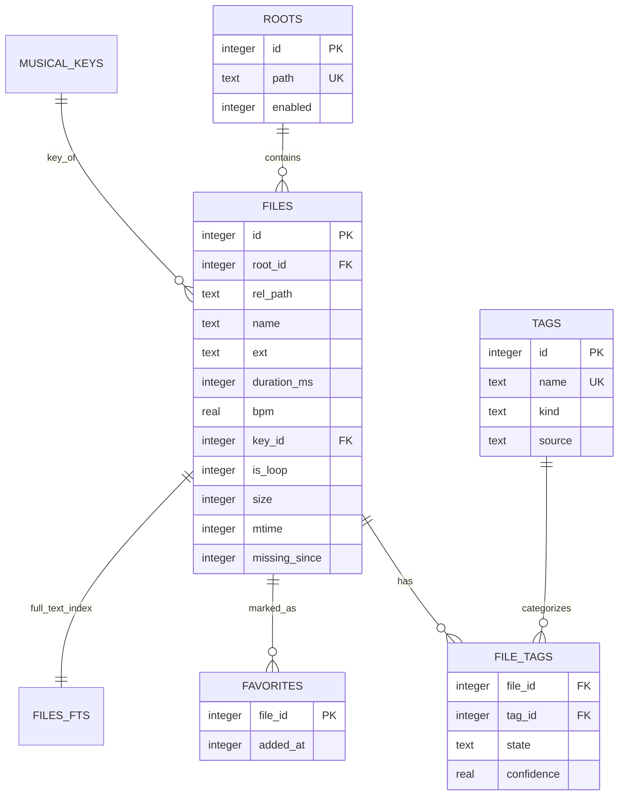

# Database and Keyset Pagination

LocSamp relies on an embedded SQLite database managed via `rusqlite` bundled with WAL (Write-Ahead Logging) and custom collation functions.

---

## Schema Architecture



---

## Key Optimization Techniques

### 1. Natural Sort Collation (`NATURALNOCASE`)
Standard SQL sorting sorts alphanumeric strings lexicographically (`Kick 1`, `Kick 10`, `Kick 2`). LocSamp registers a custom SQLite collation that chunks digits and strings, providing natural sorting directly in SQL:
```rust
db.create_collation("NATURALNOCASE", natural_sort_cmp)?;
```
Sorting produces `Kick 1`, `Kick 2`, `Kick 10`.

### 2. Window Function Total Counting
Queries execute with `LIMIT ? OFFSET ?`. To avoid running two separate queries (`SELECT ...` and `SELECT count(*)`), LocSamp uses the SQLite window function:
```sql
count(*) OVER () AS total
```
This computes the total number of matching rows in the query dataset in a single query pass.

### 3. FTS5 Quoted Prefix Queries
Search input is tokenized and quoted to prevent syntax errors:
```rust
pub fn fts_expr(q: &str) -> Option<String> {
    let terms: Vec<String> = q
        .split(|c: char| !c.is_alphanumeric() && c != '_')
        .filter(|s| !s.is_empty())
        .map(|t| format!("\"{t}\"*"))
        .collect();
    if terms.is_empty() { None } else { Some(terms.join(" ")) }
}
```
Queries like `open hat` become `"open"* "hat"*` against `files_fts`.
