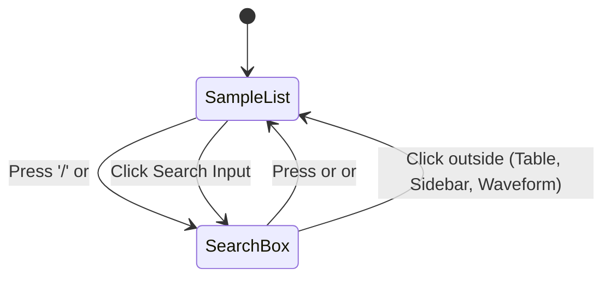

# Keyboard Navigation and Focus State Machine

LocSamp is built to be operated entirely from the keyboard without requiring mouse interaction during sound design sessions.

---

## The Focus State Machine

The interface tracks two primary interaction domains: `FocusArea::SearchBox` and `FocusArea::SampleList`.

### Deterministic Blur & Return-to-List Behavior
In immediate-mode GUI frameworks, text inputs can unintentionally trap keyboard focus after clicking or typing. LocSamp implements a strict synchronization model:
1. **Focus Loss Synchronization**: If `search_resp.has_focus()` is `false`, the focus area immediately reverts to `FocusArea::SampleList`.
2. **<kbd>Enter</kbd> to Commit**: Typing in the search bar and pressing <kbd>Enter</kbd> surrenders focus and immediately hands keyboard control to the sample table.
3. **Table Click Blurring**: Clicking anywhere in the central table panel or clicking any row sets `focus_area = FocusArea::SampleList`.

---

## Complete Keybinding Reference

| Key | Context | Action |
| :--- | :--- | :--- |
| <kbd>/</kbd> | Sample List | Focus search box |
| <kbd>Tab</kbd> | Global | Cycle focus between search box and sample list |
| <kbd>Esc</kbd> | Global | Exit Randomize/Recents view to Library, or return focus to list |
| <kbd>j</kbd> / <kbd>↓</kbd> | Sample List | Next sample (auto-loads more when reaching end of loaded chunk) |
| <kbd>k</kbd> / <kbd>↑</kbd> | Sample List | Previous sample |
| <kbd>Space</kbd> / <kbd>Enter</kbd> | Sample List | Toggle Play / Pause |
| <kbd>l</kbd> | Sample List | Retrigger sample from start (never pauses) |
| <kbd>r</kbd> | Sample List | Randomize sample (accumulates in Randomize view) |
| <kbd>Shift</kbd>+<kbd>R</kbd> | Sample List | Open in-memory Session Recents view |
| <kbd>h</kbd> | Sample List | Toggle Favorite status `[*]` |
| <kbd>gg</kbd> | Sample List | Jump to first sample |
| <kbd>G</kbd> / <kbd>Shift</kbd>+<kbd>G</kbd> | Sample List | Jump to last loaded sample |
| <kbd>yy</kbd> | Sample List | Yank file (ready to paste into Finder or drag to DAW) |
| <kbd>yp</kbd> | Sample List | Yank absolute file path to clipboard |
| <kbd>?</kbd> | Sample List | Open Vim keybindings cheat sheet modal |
