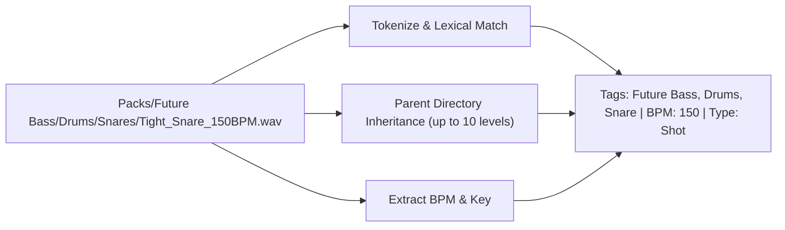

# Tagging Taxonomy and Inference

LocSamp provides out-of-the-box tag inference without requiring internet access or machine-learning models that consume GPU cycles.

---

## Clean-Room Rule Engine

The tagger operates on relative file paths and filenames using a structured dictionary:
- **38 Music Genres**: `Future Bass`, `Trap`, `Hip Hop`, `Synthwave`, `House`, `Techno`, `Drum and Bass`, etc.
- **24 Drum Categories**: `Kick`, `Snare`, `Clap`, `Hi-Hat Closed`, `Hi-Hat Open`, `Crash`, `Ride`, `Tom`, `Percussion`, etc.
- **24 Instruments**: `Bass`, `Synth`, `Piano`, `Guitar`, `Vocal`, `Pluck`, `Pad`, `Lead`, `Strings`, `Brass`, etc.
- **48 Character Descriptors**: `Acoustic`, `Electric`, `Distorted`, `Clean`, `Heavy`, `Atmospheric`, etc.

---

## Critical Rules to Prevent False Positives

1. **Word-Boundary Isolation**:
   Substrings cannot trigger false tags:
   - `clapton.wav` does NOT match `clap`.
   - `strap.wav` does NOT match `trap`.
   - `bassline.wav` correctly matches `bass`.

2. **Parent Inheritance**:
   The engine walks upward up to 10 folder levels. A file placed inside `Future Bass/Drums/Kicks/01.wav` inherits `Future Bass`, `Drums`, and `Kick` without needing those words in the filename.

3. **BPM & Key Extraction**:
   - Matches standard BPM patterns (`140bpm`, `140_bpm`, `140 bpm`). Validated against realistic ranges ($40 \le \text{BPM} \le 250$).
   - Matches musical key signatures (`F#m`, `C Major`, `Am`, `8A`, `4B`), mapping Camelot notation to standard keys.

4. **Tag Non-Resurrection**:
   User-dismissed tags are marked with `state = 'dismissed'`. Subsequent rescans will never resurrect dismissed tags.
