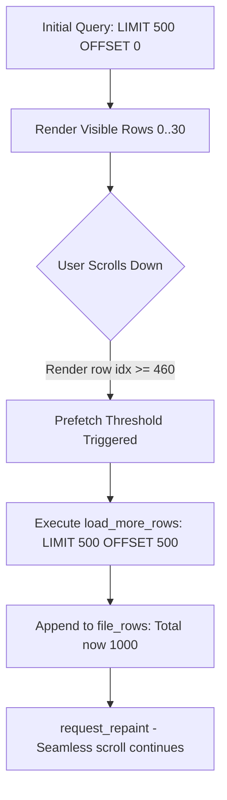

# Virtual Scrolling and Infinite Scroll

In libraries containing 50,000+ to 1,000,000+ samples, rendering full DOM/widget trees consumes gigabytes of RAM and freezes UI threads. LocSamp combines immediate-mode virtualization with dynamic chunk prefetching.

---

## The Virtualization Architecture

1. **Row Virtualization via `TableBuilder`**:
   The table height is determined by `row_height * num_rows` ($24\text{ px} \times N$). However, `egui_extras::TableBuilder` only invokes the row closure for rows physically visible within the current viewport (typically 25–35 rows).

2. **Chunk Prefetching**:
   - Initial load queries `LIMIT 500 OFFSET 0`.
   - As the user scrolls down, egui invokes the row closure for higher indices.
   - When any rendered row satisfies `idx + 40 >= file_rows.len()` and `file_rows.len() < total_results`, the app flags `needs_load_more = true`.
   - At the conclusion of table rendering:
     ```rust
     if needs_load_more {
         self.load_more_rows();
         ui.ctx().request_repaint();
     }
     ```
   - `load_more_rows` queries the next 500 items via SQLite and appends them to `self.file_rows`.
   - The user experiences smooth, uninterrupted scrolling through thousands of samples with sub-2ms query times.



3. **In-Memory Memory Footprint**:
   Each `FileRow` struct occupies approximately 160 bytes. Even after scrolling through 10,000 samples, total memory usage is ~1.6 MB—completely negligible on modern workstations.
